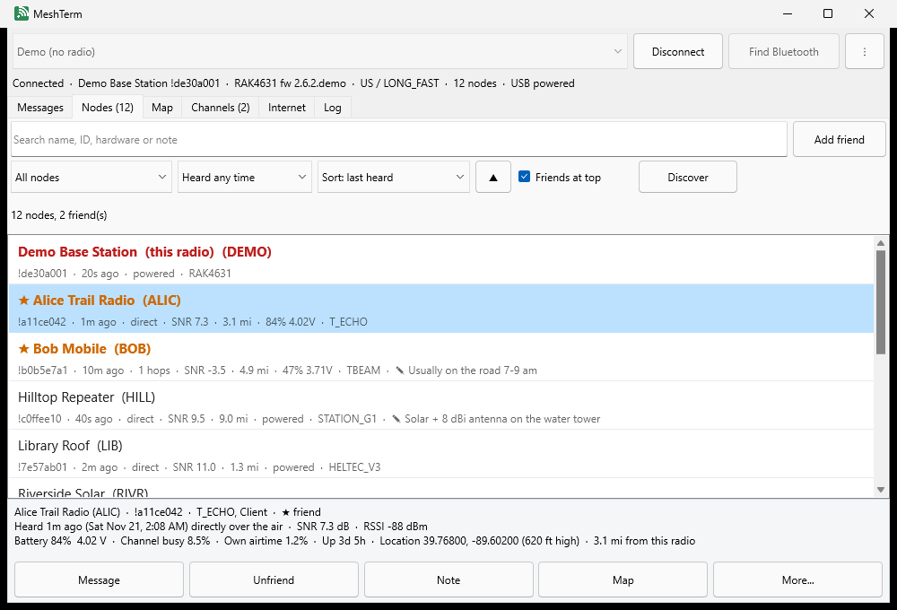
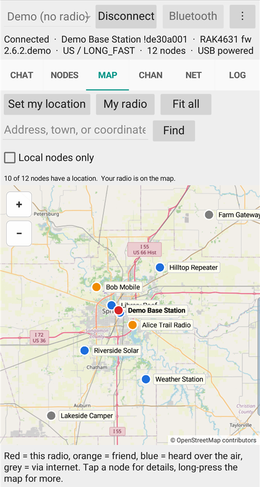
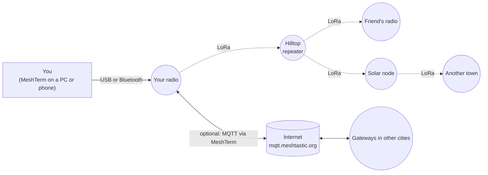
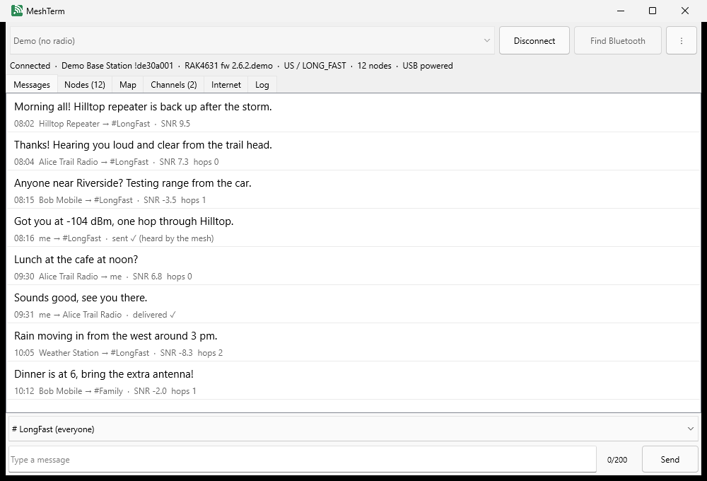
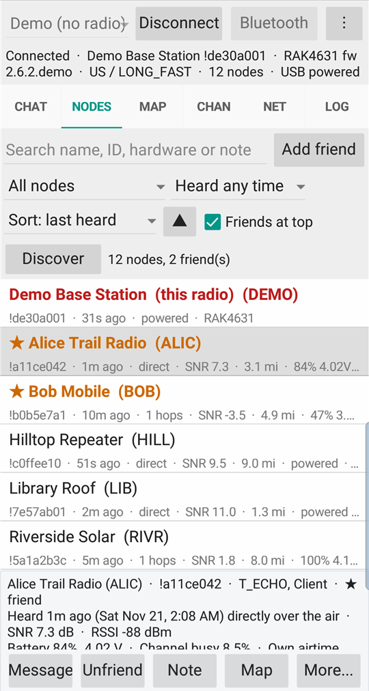
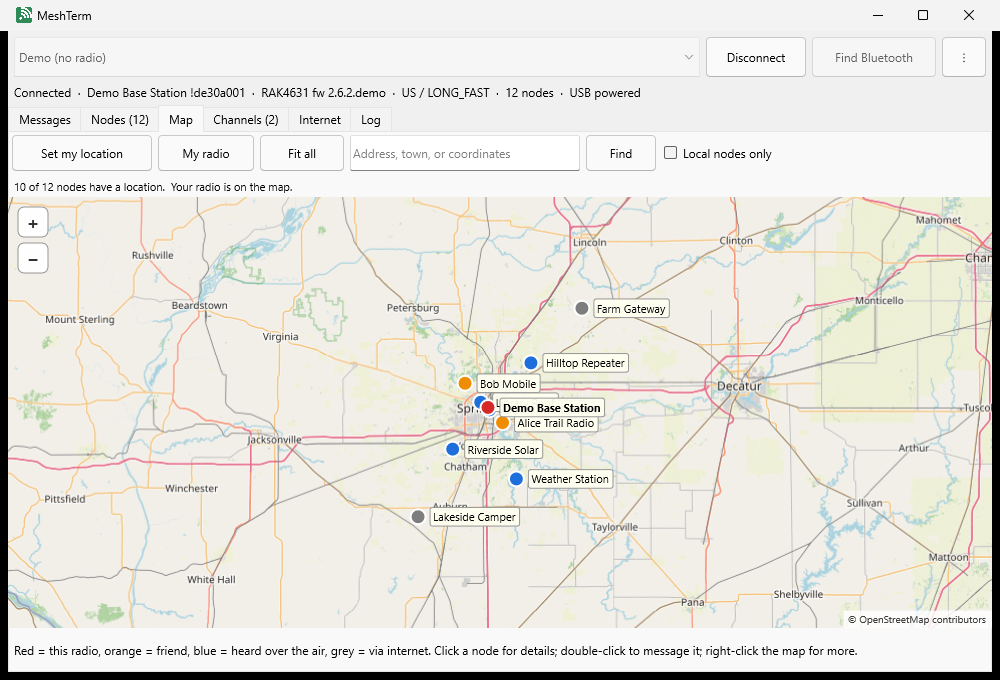
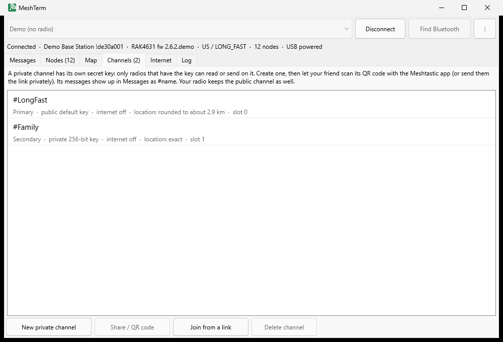
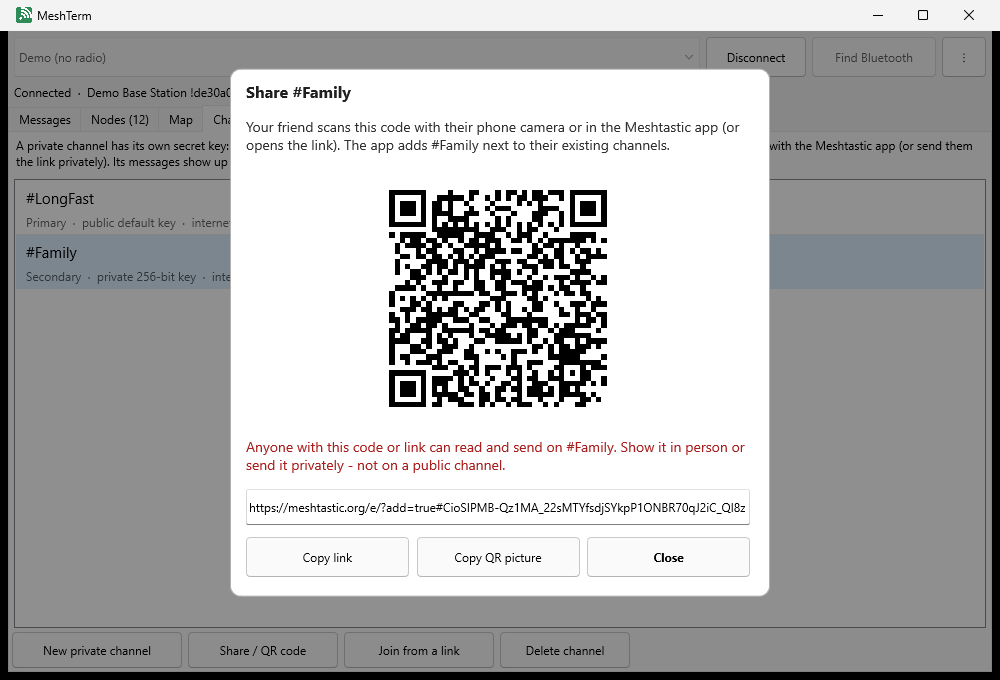
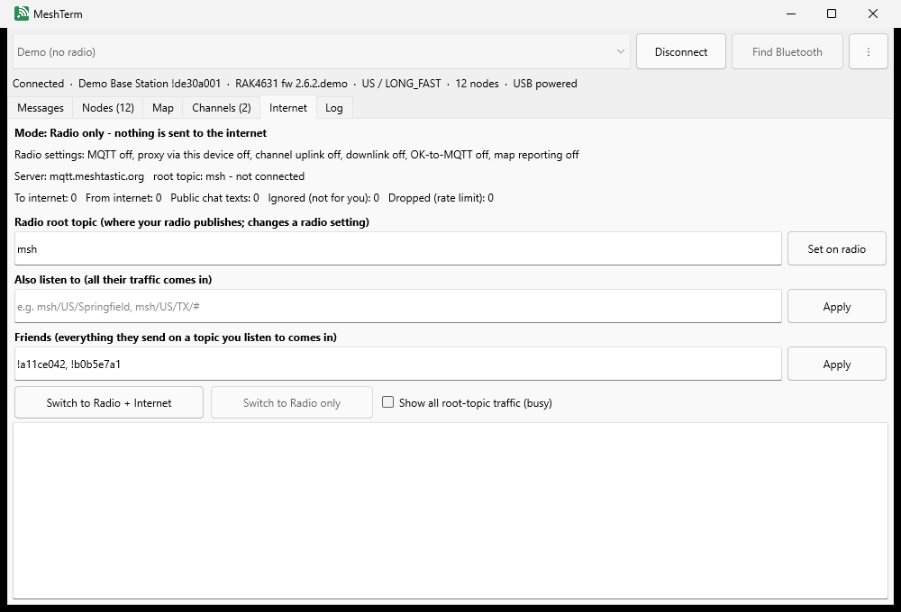

# MeshTerm

**A Windows and Android app for [Meshtastic](https://meshtastic.org) LoRa radios, written in Delphi (FireMonkey).**

MeshTerm connects to a Meshtastic radio over USB or Bluetooth. From there you can chat with people on the mesh, see who is around and where, manage friends and private channels, and optionally bridge your radio to the internet. It is one code base for the Windows PC and for Android phones.

<p align="center">
  
  &nbsp;
  
</p>

> All screenshots use MeshTerm's built-in **demo mode**: a made-up mesh around Springfield, Illinois. Every name, node ID and position in them is invented.

---

## What is this "mesh" thing?

### LoRa: long range on very little power

[LoRa](https://en.wikipedia.org/wiki/LoRa) ("long range") is a radio technique that sends small amounts of data a very long way using almost no power. The trade-offs:

- **Range:** a few kilometres in a town, 10-20 km or more from a hilltop. People have made contacts of over 300 km between mountains.
- **Speed:** very low, from about 1 to 20 kilobits per second. That is plenty for text messages and GPS positions, but not for photos or voice.
- **Licence:** none needed. It uses licence-free ISM bands (915 MHz in the US, 868 MHz in Europe, 433 MHz in some places).
- **Hardware:** a radio costs $15-50 and can run for days on a small battery, or forever from a small solar panel.

### Meshtastic: LoRa radios that relay for each other

[Meshtastic](https://meshtastic.org) is free, open-source firmware that turns those cheap LoRa boards into a **mesh network**:

- **Every radio is also a relay.** When your radio hears a message, it repeats it, so a message can hop from radio to radio until it reaches someone far beyond your own range. By default it makes up to 3 hops.
- **No phone network, Wi-Fi or internet needed.** It keeps working when the cell towers are down: hiking, camping, festivals, storms, emergencies.
- **Encrypted.** Each *channel* has an AES key. The default public channel (`LongFast` in the US) uses a well-known key, so everyone on the mesh can talk. A **private channel** uses your own random key, so only radios you have shared it with can read it. Direct messages between two nodes are end-to-end encrypted with public keys.
- **Every radio is a *node*.** Nodes announce themselves (name, hardware, battery, optionally a GPS position), so you can see who is on the mesh, how far away they are, and how well you hear them (SNR/RSSI, hops away).



### Where MeshTerm fits

The radio does the radio work. It needs a "client" to show and type messages, and Meshtastic has official apps for phones and the web. MeshTerm is an independent client that gives you:

- **A real desktop app on Windows** (with keyboard shortcuts, multi-select and a big map) and the **same app on Android**.
- **Friends and notes:** star the nodes you care about, keep private notes on any node, and filter or sort the node list any way you like.
- **An internet bridge with a filter.** The radio can hand its MQTT traffic to MeshTerm, which relays it to the public Meshtastic server. You can then reach friends in other cities. MeshTerm only lets in traffic meant for you, your friends or your private channels, so the busy public feed does not flood your radio.

---

## Features

### Messages
Channel messages and direct messages, showing who sent each one, the signal (SNR, hops) and delivery status (*sent ✓ / delivered ✓ / failed*). Everything is also saved to `messages.log`.



### Nodes and friends
- **Search** by name, node ID, hardware or your own note.
- **Filter:** friends, heard over the air, heard via the internet, direct neighbours (0 hops), has a location, has a note, or heard in the last 15 min / hour / day / week.
- **Sort** by last heard, name, distance, signal, RSSI, hops, battery, hardware, role and more, with friends kept at the top.
- **Friends:** add by ID or name, even before you have heard from them. Remove one, or several at once.
- **Notes** you keep on your own device, and a **"no battery"** flag for USB-powered radios, which report a meaningless battery reading.
- A **details panel** with battery, channel load, uptime, location, distance and when and how the node was last heard.
- **Discover** asks every node in range to reply.

| Windows | Android |
|---|---|
|  |  |

### Map
OpenStreetMap tiles with every node that shares a position. Colours: red = your radio, orange = friend, blue = heard over the air, grey = heard via the internet.

- **Moving around:** drag; pinch, the mouse wheel or the + / − buttons to zoom.
- **Your radio's location:** search for an address, town or coordinates, then set or remove your radio's fixed location (handy for radios without GPS).
- **Long-press** (Android) or **right-click** (Windows) for more options.



### Channels
Create a **private channel** with a random 256-bit key, then share it as a **QR code** or link. Your friend scans it with the Meshtastic app or opens it in MeshTerm. You can also join a channel from a link or delete one.

| Channels | Share by QR code |
|---|---|
|  |  |

### Internet (MQTT bridge)
Switch the radio between **Radio only** (nothing leaves the airwaves) and **Radio + Internet**:

- **Settings:** MeshTerm uses the radio's own MQTT settings (server, root topic) and can change the root topic for you.
- **Extra listening:** you can listen to extra regions (for example `msh/US/TX/#`) and always let in traffic from your friends.
- **Flood protection:** MeshTerm rate-limits what it sends to the radio, so a busy feed can't swamp it.



### Alerts and the rest
- **Notifications** (Windows toast or Android) for direct messages, friends and private channels. You can choose to get them only when you're not looking at MeshTerm.
- **Auto-reconnect** after the radio reboots (settings changes reboot it) or is unplugged.
- A **Log** tab, with the radio's own debug output if you want it.

---

## Getting started

1. **Get a Meshtastic radio.** The author's is a Seeed XIAO nRF52840 with a Wio-SX1262 LoRa board ($15-25). Kits such as the RAK WisBlock, LilyGO T-Echo / T-Beam, Heltec V3 or SenseCAP T1000-E all work. Flash Meshtastic with the [web flasher](https://flasher.meshtastic.org) and **set your region** (for example US). A radio with no region set will not transmit.
2. **Connect MeshTerm:**
   - **USB:** plug the radio in, pick its COM port (Windows) or USB device (Android, with an OTG cable), and tap **Connect**.
   - **Bluetooth:** tap **Find Bluetooth**, then **Connect**. Android asks for the radio's PIN the first time (the default is `123456`). On **Windows, pair the radio once in Settings → Bluetooth & devices first**, because Windows does not ask for the PIN on its own.
3. **Say hello** on the public channel, or tap a node and **Message** it.

The radio accepts **one Bluetooth connection at a time**, so disconnect your phone before connecting from the PC.

Settings live in `MeshTerm.ini` in `%APPDATA%\MeshTerm` on Windows, or the app's own folder on Android.

### Privacy notes
- On the public channel, anyone in range (or on the internet, if a gateway relays it) can read what you send. Use a private channel or a direct message for anything personal.
- Your position is only shared if your radio has one, and only as precisely as each channel allows. The public channel rounds it to about 3 km by default.
- In **Radio + Internet** mode, your channel traffic is published to the public MQTT server. MeshTerm explains this before switching.

---

## Building

You need **Delphi 13 (RAD Studio 37.0)** with the Android SDK, which installs with Delphi. No third-party components are used: the Meshtastic protobuf protocol, AES, MQTT and the QR code encoder are all written in plain Pascal.

```
build-x.bat                    Windows 64-bit  ->  Win64\Debug\MeshTermX.exe
build-x.bat android            Android 64-bit APK
build-x.bat android install    build, then install with adb
```

Or open `MeshTermX.dproj` in the IDE.

**Demo mode** (the screenshots): run `MeshTermX.exe -demo` (add `-tab nodes|map|channels|internet|log` or `-share`). On Android, put an empty `demo.flag` file next to `MeshTerm.ini`. Demo mode never touches your settings or a radio.

### Source layout

| Unit | What it does |
|---|---|
| `Meshtastic.Proto` | Meshtastic protobuf encoding and decoding |
| `Meshtastic.Client` | the radio session: config download, node database, messages, admin settings |
| `Meshtastic.Transport` | serial framing and the transport factory |
| `Meshtastic.Port`, `.Usb.Android`, `.Ble` | Windows COM ports, Android USB host, Bluetooth LE |
| `Meshtastic.Crypto` | AES-CTR for the default channel key, secure random |
| `Meshtastic.Mqtt`, `.Bridge` | a minimal MQTT client and the radio-to-internet bridge |
| `Meshtastic.Settings`, `.NodeView`, `.Places`, `.Demo` | settings, node filtering and sorting, place search, demo data |
| `MapViewX` | the OpenStreetMap control (tile cache, touch and mouse) |
| `FmxSheet` | non-blocking dialogs that work the same on Windows and Android |
| `MainFormX` | the user interface, built in code |
| `QrCode` | the QR code encoder |

---

*Map data © [OpenStreetMap](https://www.openstreetmap.org/copyright) contributors. Meshtastic® is a registered trademark of Meshtastic LLC. MeshTerm is an independent project and is not affiliated with Meshtastic LLC.*
